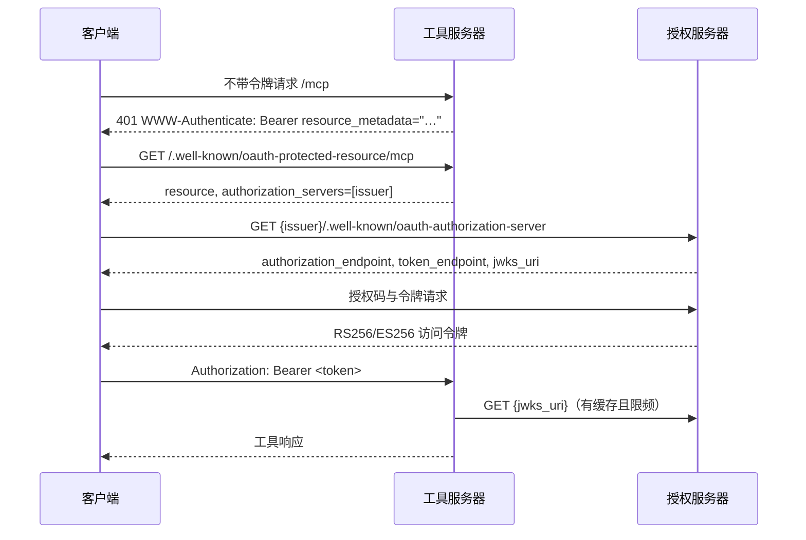

# 使用外部授权服务器部署

本指南把 `toolregistry-server` 配置为独立的授权服务器（AS）之前的 OAuth 2.0 资源服务器。
内容与厂商无关：issuer 写作 `https://auth.example.com`，服务器公开 URL 写作
`https://tools.example.com`。

服务器不签发令牌，也没有内置 AS。它在本地校验 JWT，因此 AS 必须用 RS256 或 ES256 签名并
公布密钥。

## 发现链



双方的职责：

| 一方 | 公布 | 期望 |
|------|------|------|
| 工具服务器 | RFC 9728 受保护资源元数据；带 `resource_metadata` 的 401 质询；OpenAPI `OAuth2` 方案 | `iss` 与 `--oauth-issuer` 一致、`aud` 或 `resource` 包含 audience 且未过期的 JWT |
| 授权服务器 | RFC 8414 元数据（或 OIDC 发现），含 `authorization_endpoint`、`token_endpoint` 与 `jwks_uri`；JWKS 端点 | 一个已注册客户端，其重定向 URI 与客户端实际发送的完全一致 |

服务器先读 RFC 8414 文档中的 `jwks_uri`，再尝试 `/.well-known/openid-configuration`，最后才
回退到 `<issuer>/.well-known/jwks.json`。两份元数据都不提供的提供方需要 `--oauth-jwks`。
最后回退在拼接 URL 前会去掉 issuer 的末尾斜杠，因此以 `https://auth.example.com/` 公布的
issuer 会拼接为 `https://auth.example.com/.well-known/jwks.json`，不会出现双斜杠；`iss`
比较本身仍逐字节进行。

## 第 1 步 — 配置授权服务器

1. 为每个客户端应用（Gemini、Claude、ChatGPT、Swagger）创建一个客户端。把客户端显示的
   重定向 URI **原样**注册；末尾斜杠或主机不同都算不同的 URI。
2. 启用部署要授予的作用域（例如 `openid profile email offline_access tools:read`）。
3. 确定 AS 支持哪种客户端注册方式：
   - **CIMD** — 客户端给出自身客户端元数据文档的 URL；
   - **DCR** — 客户端动态注册自己；
   - **手动注册** — 你把客户端 ID（和密钥）填进客户端。

   工具服务器不决定这件事；客户端与 AS 必须支持同一种方式。

## 第 2 步 — 启动服务器

```bash
toolregistry-server gateway \
  --config config.yaml \
  --host 127.0.0.1 \
  --port 8080 \
  --server-url https://tools.example.com/mcp \
  --oauth-issuer https://auth.example.com \
  --oauth-audience https://tools.example.com/mcp \
  --oauth-scopes "openid profile email offline_access tools:read" \
  --oauth-scope "tools:read=calculator,web"
```

各字段含义：

- `--oauth-issuer` 必须与 AS 写入令牌的 `iss` 完全一致。
- `--oauth-audience` 必须与 AS 写入 `aud`（或 RFC 8707 `resource` 声明）的值一致。请让 AS
  签发 `resource=https://tools.example.com/mcp`。
- `--oauth-scopes` 会公布给客户端并写入 OpenAPI 文档。它必须是 AS 实际签发作用域的子集，
  否则客户端可能在 authorize 阶段失败。
- `--oauth-scope` 把签发的作用域映射到工具命名空间。每个需要授予访问的作用域都要重复一次。

### 其他命令的同类配置

```bash
# 独立 OpenAPI 服务器
toolregistry-server openapi --config config.yaml \
  --oauth-issuer https://auth.example.com \
  --oauth-audience https://tools.example.com

# 独立 MCP 服务器（HTTP 传输）
toolregistry-server mcp --config config.yaml --transport streamable-http \
  --server-url https://tools.example.com/mcp \
  --oauth-issuer https://auth.example.com

# 常驻 hub（Unix socket）
toolregistry-server local-hub run --config config.yaml --keys-db keys.db \
  --oauth-issuer https://auth.example.com \
  --oauth-audience https://tools.example.com/mcp
```

`local-hub` 必须显式给出 audience：它的监听地址没有可推导的公开地址。

## 第 3 步 — 连接客户端前先验证发现

```bash
curl -s https://tools.example.com/.well-known/oauth-protected-resource/mcp | jq
# {"resource": "https://tools.example.com/mcp",
#  "authorization_servers": ["https://auth.example.com"], …}

curl -s https://auth.example.com/.well-known/oauth-authorization-server | jq
# {"issuer": "https://auth.example.com",
#  "authorization_endpoint": "https://auth.example.com/authorize",
#  "token_endpoint": "https://auth.example.com/token",
#  "jwks_uri": "https://auth.example.com/jwks", …}
```

第一个请求返回 `404` 说明启动的命令没有配置 OAuth。第二个返回 `404` 说明 AS 不提供 RFC 8414
元数据；请配置 `--oauth-jwks`，Swagger 还需要两个端点覆盖选项。

## 反向代理之后

元数据必须公布客户端能访问的 URL，而不是进程绑定的地址：

- `gateway` 与 `mcp`：传入 `--server-url https://tools.example.com/mcp`。
- `openapi`：没有 `--server-url`；请用 `--oauth-audience` 传入公开源，OpenAPI 端点由发现提供。
- 绑定 `0.0.0.0` 或 `::` 且未提供公开 URL 时会记录警告，并生成客户端无法访问的 PRM URL。
  服务器不读取 `X-Forwarded-*`；请在代理处终止 TLS 并显式设置公开 URL。
- 绑定 Unix socket 的 gateway 未设置 `--server-url` 时不公布 PRM，401 质询只发送裸 `Bearer`，
  这是有意为之：没有可公布的公开地址。

## 最小权限的作用域映射

只映射部署需要的作用域，并把每个映射到最窄的命名空间集合：

```bash
--oauth-scope "tools:read=calculator,web" \
--oauth-scope "tools:admin=admin"
```

作用域未被映射的令牌不能调用任何工具。`*` 匹配所有命名空间，**仅限测试**；生产令牌带 `*`
即可访问所有工具，包括破坏性或文件系统工具。AS 侧没有通配符替换：AS 签发作用域，这里决定
它授予什么。

一个作用域条目还可以用 `+tool-name` 与 `-tool-name` 允许或拒绝单个工具：

```bash
--oauth-scope "tools:read=calculator,+web-search,-calculator-danger"
```

它授予 `calculator` 命名空间，在命名空间未列出时仍允许 `web-search`，并在允许的命名空间内
拒绝 `calculator-danger`。两个被授予的作用域对同一工具意见不一致时，拒绝优先。

## 用内省实现及时撤销

本地 JWT 校验看不到令牌签发之后发生的撤销，因此令牌会一直有效到过期。若这个窗口太长，请
配置 RFC 7662 内省端点：

```bash
--oauth-introspection-url https://auth.example.com/introspect \
--oauth-introspection-client-id toolregistry \
--oauth-introspection-client-secret "$INTROSPECTION_SECRET" \
--oauth-introspection-cache-ttl 5
```

- 端点在本地校验之后调用，因此 AS 必须仍签发 RS256 或 ES256 JWT。内省不会让不透明令牌可用。
- 结果按令牌缓存 TTL，该 TTL 就是被撤销令牌仍被接受的最长时间。默认 5 秒；`0` 表示每个
  请求都内省。
- 端点失败时默认拒绝令牌。若可用性比立即撤销更重要，可加 `--oauth-introspection-optional`
  回退到本地结果。
- 同样的设置可以写在配置文件的 `oauth:` 段中：`introspection_url`、
  `introspection_client_id`、`introspection_client_secret`、`introspection_cache_ttl`
  与 `introspection_optional`，按客户端上限写在 `client_concurrency`。选项优先于文件。
  该段中未知的键会在启动时被拒绝而不是被忽略，非法的按客户端上限会指明来源
  （`oauth.client_concurrency['reports-bot']`）。

内省端点需要自己的客户端凭据，它不是最终用户授权的那个客户端。若进程列表可见，不要让该
密钥出现在命令行中——配置文件是更合适的位置。

## 按客户端并发

`--client-concurrency` 是每客户端的上限。对 OAuth 客户端，可以用以下任一方式收紧：

```bash
--oauth-client-concurrency reports-bot=2 \
--oauth-concurrency-claim max_concurrency
```

声明中的正整数优先于静态条目。无效的声明会被忽略，而不是拒绝令牌。

预算属于 OAuth 客户端，而不是它的某个用户：同一客户端代表的所有 `sub` 共享一个在途
上限，键为 `oauth:<client_id>`。预算按客户端单调不增——声明值宽于当前生效的上限时不会
提高它，更窄的声明则会降低它——因此一个用户无法扩大其他人共享的上限。两个不同的客户端
从不共享预算。

记账仍按 principal：执行日志行与密钥计数依然带上客户端与 `sub`，因此同一客户端的两个
用户虽然共享上限，仍可区分。等待超时的调用会以 `busy` 结果记录。

## 故障排查

| 现象 | 可能原因 | 处理 |
|------|----------|------|
| 客户端在 authorize 与回调之间反复跳转 | 重定向 URI 不匹配，或 AS 拒绝请求的作用域 | 注册完全一致的重定向 URI；让 `--oauth-scopes` 成为 AS 支持作用域的子集 |
| 令牌看似有效但持续 `401` | `iss` 不匹配（末尾斜杠、realm 大小写） | 使用精确的 issuer 字符串；服务器逐字节比较 |
| 只有某个客户端 `401` | audience/resource 不匹配 | 让 `aud` 或 `resource` 等于 `--oauth-audience`；MCP 使用公开的 `/mcp` URL |
| 密钥轮换后全部失败 | 新 `kid` 不在缓存的 JWKS 中 | 服务器最多每 30 秒重新拉取一次；立即重试的客户端可能看到一次失败。确认 AS 已在新 `jwks_uri` 公布新密钥 |
| 没有 PRM 路由 | 未启用 OAuth、MCP 前端被禁用，或 socket hub 没有 `--server-url` | 检查 401 质询与启动日志 |
| 服务器无法访问 AS 元数据 | 私有网络，或 AS 不提供 RFC 8414 文档 | 传入 `--oauth-jwks`（Swagger 还需 `--oauth-authorization-url` / `--oauth-token-url`） |
| 客户端提示不支持动态注册 | AS 关闭了 DCR，或客户端需要 CIMD | 在 AS 启用 DCR 或 CIMD，或预先注册客户端并手动填入凭据 |
| Swagger 的 Authorize 没有反应 | 文档没有 OAuth2 方案 | 确认设置了 `--oauth-issuer` 且端点可解析；否则方案会被省略并记录警告 |
| AS 回调后 Swagger 停在 404 | AS 注册的重定向 URI 与服务提供的重定向页不一致 | 注册 `<公开源><openapi 路径>/oauth2-redirect.html`；页面随 `--openapi-path` 移动 |
| 启用内省后所有令牌都被拒绝 | 端点不可达，或客户端 id 与密钥有误 | 检查启动日志与端点；加上 `--oauth-introspection-optional` 回退到本地校验可确认这一判断。失败结果会按 TTL 缓存，下一次探测在一个 TTL 之后，而不是下一个请求 |
| 已撤销的令牌仍然可用 | 未配置内省端点，或缓存 TTL 尚未到期 | 配置 `--oauth-introspection-url`，并缩短 `--oauth-introspection-cache-ttl`（默认 5 秒） |

## 另见

- [OAuth 参考](../reference/oauth.md) — 全部选项及其优先级。
- [认证指南](authentication.md) — 校验规则。
- [连接 OAuth 客户端](oauth-clients.md)。
