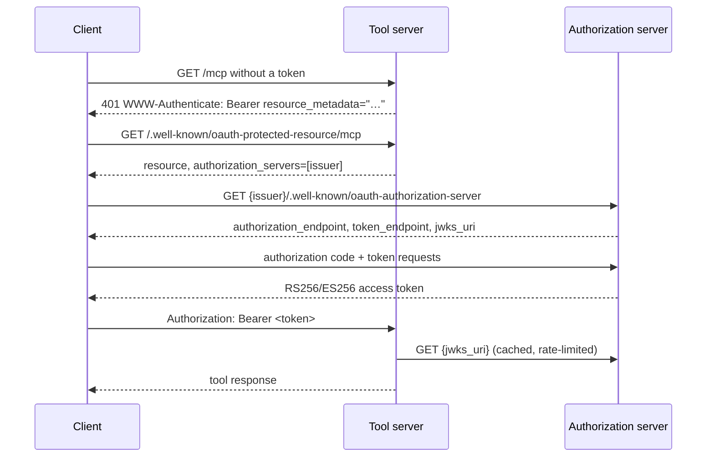

# Deploying with an External Authorization Server

This guide configures `toolregistry-server` as an OAuth 2.0 resource server
in front of a separate authorization server (AS). It is vendor-neutral: the
issuer is written as `https://auth.example.com` and the public server URL as
`https://tools.example.com`.

The server does not issue tokens and has no built-in AS. It verifies JWTs
locally, so the AS must sign with RS256 or ES256 and publish its keys.

## The discovery chain



What each side provides:

| Side | Publishes | Expects |
|------|-----------|---------|
| Tool server | RFC 9728 protected-resource metadata; a `resource_metadata` 401 challenge; the OpenAPI `OAuth2` scheme | A JWT whose `iss` matches `--oauth-issuer`, whose `aud` or `resource` contains the audience, and which is unexpired |
| Authorization server | RFC 8414 metadata (or OIDC discovery) with `authorization_endpoint`, `token_endpoint` and `jwks_uri`; a JWKS endpoint | A registered client with the exact redirect URI used by the client |

The server reads `jwks_uri` from the RFC 8414 document, then from
`/.well-known/openid-configuration`, and only then falls back to
`<issuer>/.well-known/jwks.json`. Providers that publish neither metadata
document need `--oauth-jwks`.

## Step 1 — configure the authorization server

1. Create a client for each client application (Gemini, Claude, ChatGPT,
   Swagger). Register the redirect URI the client shows you **verbatim**;
   a trailing slash or a different host is a different URI.
2. Enable the scopes the deployment will honour (for example
   `openid profile email offline_access tools:read`).
3. Decide whether the AS offers:
   - **CIMD** — a client presents a URL to its own client-metadata document;
   - **DCR** — the client registers itself dynamically;
   - **manual registration** — you copy a client ID (and secret) into the
     client.

   Tool servers do not choose this; the client and the AS must support the
   same mechanism.

## Step 2 — start the server

```bash
toolregistry-server gateway \
  --config config.yaml \
  --host 127.0.0.1 \
  --port 8080 \
  --server-url https://tools.example.com/mcp \
  --oauth-issuer https://auth.example.com \
  --oauth-audience https://tools.example.com/mcp \
  --oauth-scopes "openid profile email offline_access tools:read" \
  --oauth-scope "tools:read=calculator,web"
```

Fields:

- `--oauth-issuer` must be the exact `iss` the AS puts in its tokens.
- `--oauth-audience` must match what the AS puts in `aud` (or in the RFC 8707
  `resource` claim). Ask the AS to mint `resource=https://tools.example.com/mcp`.
- `--oauth-scopes` is published to clients and in the OpenAPI document. It
  must be a subset of what the AS will actually issue, or clients can fail
  at the authorize step.
- `--oauth-scope` maps an issued scope to tool namespaces. Repeat it for
  every scope that should grant access.

### Same settings for the other commands

```bash
# Standalone OpenAPI server
toolregistry-server openapi --config config.yaml \
  --oauth-issuer https://auth.example.com \
  --oauth-audience https://tools.example.com

# Standalone MCP server (HTTP transport)
toolregistry-server mcp --config config.yaml --transport streamable-http \
  --server-url https://tools.example.com/mcp \
  --oauth-issuer https://auth.example.com

# Resident hub (Unix socket)
toolregistry-server local-hub run --config config.yaml --keys-db keys.db \
  --oauth-issuer https://auth.example.com \
  --oauth-audience https://tools.example.com/mcp
```

`local-hub` must be told the audience explicitly: its listener has no public
address to derive one from.

## Step 3 — verify discovery before connecting a client

```bash
curl -s https://tools.example.com/.well-known/oauth-protected-resource/mcp | jq
# {"resource": "https://tools.example.com/mcp",
#  "authorization_servers": ["https://auth.example.com"], …}

curl -s https://auth.example.com/.well-known/oauth-authorization-server | jq
# {"issuer": "https://auth.example.com",
#  "authorization_endpoint": "https://auth.example.com/authorize",
#  "token_endpoint": "https://auth.example.com/token",
#  "jwks_uri": "https://auth.example.com/jwks", …}
```

If the first request answers `404`, OAuth is not configured on the command you
started. If the second answers `404`, the AS does not publish RFC 8414
metadata; configure `--oauth-jwks` and, for Swagger, the two endpoint
overrides.

## Behind a reverse proxy

The metadata must advertise the URL clients reach, not the address the
process binds:

- `gateway` and `mcp`: pass `--server-url https://tools.example.com/mcp`.
- `openapi`: there is no `--server-url`; pass `--oauth-audience` with the
  public origin and expect the OpenAPI endpoints to come from discovery.
- Binding `0.0.0.0` or `::` without a public URL logs a warning and produces
  a PRM URL no client can follow. The server does not read
  `X-Forwarded-*`; terminate TLS at the proxy and set the public URL
  explicitly.
- On a Unix-socket gateway without `--server-url`, no PRM is published and
  the 401 challenge carries a bare `Bearer`, by design: there is no public
  address to advertise.

## Least-privilege scope mapping

Map only the scopes the deployment needs, and map each to the narrowest
namespace set:

```bash
--oauth-scope "tools:read=calculator,web" \
--oauth-scope "tools:admin=admin"
```

A token whose scopes are unmapped can call nothing. `*` matches every
namespace and is **test-only**; a production token with `*` can reach every
tool, including destructive or file-system tools. There is no wildcard
substitution on the AS side: the AS issues the scope, and this mapping
decides what it grants.

## Troubleshooting

| Symptom | Likely cause | Fix |
|---------|--------------|-----|
| Client loops between authorize and callback | Redirect URI mismatch, or the AS rejects the requested scope | Register the exact redirect URI; make `--oauth-scopes` a subset of the AS's supported scopes |
| Repeated `401` with a valid-looking token | `iss` mismatch (trailing slash, realm casing) | Use the exact issuer string; the server compares it byte for byte |
| `401` only from one client | Audience/resource mismatch | Mint `aud` or `resource` equal to `--oauth-audience`; for MCP that is the public `/mcp` URL |
| Everything breaks after a key rotation | The new `kid` was not in the cached JWKS | The server refetches at most once per 30 seconds; a client that retries immediately can see one failure. Check that the AS publishes the new key at `jwks_uri` |
| No PRM route | OAuth not enabled, or the MCP frontend is disabled, or a socket hub has no `--server-url` | Check the 401 challenge and the startup log |
| AS metadata unreachable from the server | Private network or the AS publishes no RFC 8414 document | Pass `--oauth-jwks` (and, for Swagger, `--oauth-authorization-url` / `--oauth-token-url`) |
| Client says dynamic registration is unsupported | DCR is disabled at the AS, or the client needs CIMD | Enable DCR or CIMD at the AS, or pre-register the client and enter its credentials manually |
| Swagger "Authorize" does nothing | The document has no OAuth2 scheme | Confirm `--oauth-issuer` is set and the endpoints are resolvable; the scheme is omitted with a warning otherwise |

## See also

- [OAuth reference](../reference/oauth.md) — every flag and its precedence.
- [Authentication guide](authentication.md) — verification rules.
- [Connecting OAuth clients](oauth-clients.md).
